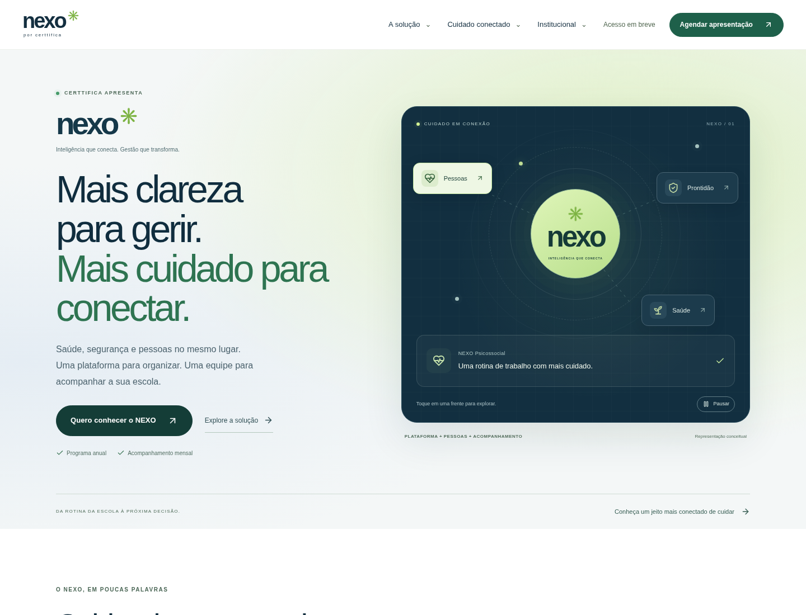

# NEXO · Certtifica

Site institucional e comercial em português do Brasil. Next.js App Router, TypeScript, Tailwind CSS 4, componentes próprios, ícones Lucide e backend Node.js. Assinatura NEXO provisória; identificação Certtifica somente textual, sem reprodução de logotipo oficial.



## Desenvolvimento

Requisitos: Node.js 24 (inclui `node:sqlite`), npm e Chromium para testes de navegador. Use o checkout existente; as tarefas na nuvem já são isoladas e não precisam de worktree adicional.

```bash
cd /workspace/Escola
npm ci
cp .env.example .env.local # somente se o arquivo ainda não existir
npm run dev
```

Configure uma senha exclusiva de pelo menos 16 caracteres em `ADMIN_PASSWORD` no arquivo local ignorado, sem expô-la em chat, logs ou código. Reinicie o servidor após mudanças de ambiente. Não há senha padrão. O site público funciona sem senha; a área `/admin` permanece indisponível até configurá-la. O comando de desenvolvimento usa a porta 3000. O banco SQLite é criado na primeira operação que precisa de persistência, em `.data/nexo.sqlite` (diretório 0700, arquivo 0600). Nunca versionar `.data`, arquivos de ambiente, backups nem rastros de testes com dados pessoais.

## Verificação

```bash
npm run lint
npm run typecheck
npm test
npm run test:e2e
npm run build
```

Os testes unitários cobrem validação e assinatura de sessões. E2E usa Chromium em `/usr/bin/chromium` (substitua com `CHROMIUM_PATH`), porta 3100 exclusiva, banco temporário e senha aleatória somente para testes. Cobre as 18 rotas públicas, metadados, 404, menu em celular, painel interativo, exploração das frentes, cenários da rotina, jornada clicável, FAQ, pausa de animações, envio real, consulta e exclusão autenticadas e auditoria axe WCAG A/AA em páginas representativas. Capturas de desktop/celular em `test-results/`, ignoradas pelo Git. Auditoria automatizada não comprova conformidade WCAG completa; revisão manual com teclado, leitores de tela e dispositivos reais continua necessária.

## Rotas

`/`, `/solucao`, `/modulos`, `/psicossocial`, `/prontidao`, `/ser-saude`, `/central-de-inteligencia`, `/como-funciona`, `/acreditacao`, `/experiencias`, `/experiencia-digital`, `/sobre`, `/visao-de-futuro`, `/conteudos`, `/contato`, `/agendar-apresentacao`, `/privacidade`, `/termos`. Administração em `/admin`. Sitemap e robots gerados automaticamente.

## Captação e consulta

`POST /api/leads` valida conteúdo no servidor, tamanho, campos obrigatórios, interesse, e-mail, telefone e consentimentos. Inclui honeypot, tempo mínimo de preenchimento, restrição de origem e limite persistente de cinco envios por dez minutos. Em Vercel usa IP fornecido pelo cabeçalho da plataforma, pseudonimizado por HMAC; fora dela usa um limite compartilhado conservador e não confia em cabeçalhos arbitrários. Não armazenamos IP original. Para maior tráfego, configurar proxy confiável e proteção de borda/CAPTCHA com revisão de privacidade. Não há garantia absoluta contra bots.

O sucesso só é apresentado após confirmação do banco, com protocolo. O agendamento é uma **solicitação de apresentação**, não reserva automática de horário. Nenhum e-mail, CRM ou mensagem de WhatsApp é enviado automaticamente. A equipe deve consultar `/admin` e organizar o retorno.

Administração: `POST /api/admin/login` verifica a senha em tempo constante e emite cookie HttpOnly, SameSite Strict, Secure em produção, duração de oito horas. Dez tentativas por quinze minutos. `GET /api/admin/leads?page=0` consulta 50 registros por página; `DELETE /api/admin/leads?id=UUID` exclui um registro, ambos autenticados. `POST /api/admin/logout` encerra a sessão. Consultas não têm cache. Rotacionar a senha invalida sessões existentes. O modelo de senha compartilhada é para uma operação pequena; para múltiplos operadores, integrar SSO/MFA e trilha de auditoria antes de ampliar a equipe.

## Banco em produção / Vercel

Configure Node.js 24.x, build `npm run build` e framework Next.js. Defina `DATABASE_URL` para PostgreSQL persistente e `ADMIN_PASSWORD` de forma segura nas variáveis do provedor. Configure `NEXT_PUBLIC_SITE_URL` com o domínio HTTPS final **antes do build**, incluindo para a validação de origem. Variáveis `NEXT_PUBLIC_*` são públicas e incorporadas ao build; nunca use-as para segredos. Configure `NEXT_PUBLIC_NEXO_URL` apenas com o endereço HTTPS confirmado do sistema. Sem endereço, o site informa que o acesso ainda não está disponível. WhatsApp é opcional em `NEXT_PUBLIC_WHATSAPP_NUMBER`, só dígitos no formato internacional confirmado.

As tabelas `leads` e `rate_limits` são criadas automaticamente com SQL parametrizado e idempotente. O usuário do banco precisa de permissão de criação na primeira execução; para produção, pode-se criar as tabelas previamente usando o esquema em `lib/db.ts` e reduzir os privilégios. O PostgreSQL gerenciado deve exigir TLS com verificação de certificado válida. Use a configuração oficial de conexão do provedor; não desative validação TLS. Se o provedor precisar de CA específica, configure a cadeia de confiança aprovada no runtime. SQLite é recusado em `NODE_ENV=production`, evitando armazenamento efêmero na Vercel.

O adaptador PostgreSQL está implementado, mas requer banco real para validação de implantação; o ambiente de desenvolvimento é validado com SQLite. Não há migração automática entre os dois bancos. Configure backups criptografados, controle de acesso ao provedor e restauração antes de captar dados reais. Não publicar antes de configurar a administração e testar uma solicitação ponta a ponta no ambiente final.

## Privacidade e retenção

O formulário separa ciência de privacidade da autorização opcional de comunicações adicionais; registra versão do aviso, horário e origem. Não solicita informações de saúde ou de menores. A administração permite exclusão. Rotina de expurgo:

```bash
# Com as variáveis do banco já carregadas no ambiente:
npx tsx scripts/purge.ts 180
```

O prazo de 180 dias é proposta inicial para revisão jurídica. Agende a rotina conforme a política aprovada; ela não é executada automaticamente pelo site. Também revise a política de backups. O banner salva preferências no navegador e emite `nexo:consent` com `detail.analytics`; nenhum analytics ou pixel é instalado. Integrações futuras devem ler a preferência já salva, respeitar revogação e carregar somente após autorização aplicável. A identificação jurídica e o canal oficial de exercício de direitos ainda precisam ser confirmados.

## Integrações futuras

CRM: integrar no servidor somente após persistência, preferencialmente com fila, idempotência pelo protocolo e política de repetição; credenciais somente no servidor. Agenda: escolher um provedor e criar disponibilidade/reservas reais antes de comunicar uma reunião confirmada. WhatsApp: o link só aparece se o número confirmado estiver configurado. Analytics: escolher provedor e documentar finalidades, operadores e consentimentos antes de ativar. Nenhuma integração externa está implicitamente ativa.

## Conteúdo e pendências externas antes de publicar

- Arquivos oficiais da marca Certtifica, aprovação da assinatura NEXO e identidade final. Nenhum logotipo oficial ou fotografia pessoal foi inventado.
- Confirmação de nomes públicos, responsabilidades, biografias e autorizações da equipe. Os nomes fornecidos no briefing aparecem apenas em nota de confirmação pendente.
- Razão social, CNPJ, endereço, canal de privacidade e contato comercial confirmados.
- Revisão jurídica e técnica de LGPD, NR-1, Lei Lucas, privacidade, termos e escopo contratado.
- Critérios, validade e condições de concessão da Acreditação NEXO. Selos ilustrativos não comprovam concessões e não representam planos de assinatura.
- Banco PostgreSQL, senha administrativa, domínio, URL real do sistema, eventual WhatsApp e processo de retorno dos contatos.
- Teste do adaptador PostgreSQL, backups e expurgo no ambiente definitivo; revisão manual de acessibilidade e SEO/social cards. O Open Graph usa PNG gerado em `/opengraph-image`.

Não há clientes, depoimentos, estatísticas de resultados, credenciais ou parcerias inventadas. Os números do painel são fictícios. Expansão para redes, observatório, municípios e cidades inteligentes é identificada como visão futura. Experiências e modernização digital dependem de contratação específica. Não há ERP acadêmico ou financeiro neste projeto.

Nenhum deploy, merge ou publicação é realizado automaticamente.

## Experiência visual e interações

A página inicial apresenta o programa em mensagens curtas: o que é, como ajuda e como acontece. O mapa de conexões permite explorar Pessoas, Prontidão e Saúde; as abas mostram exemplos concretos, identificados como ilustrativos. A comparação de situações da rotina, a jornada em três etapas e as perguntas frequentes respondem a cliques e teclado, sem carrosséis automáticos.

As animações decorativas contínuas do mapa têm controle de pausa. A preferência `prefers-reduced-motion` é respeitada nas animações CSS e nas entradas em rolagem. Conteúdo permanece disponível sem depender de animações. O indicador no cabeçalho acompanha o progresso de leitura.
