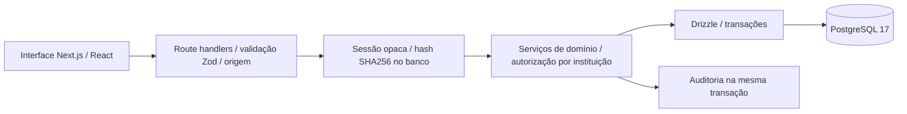
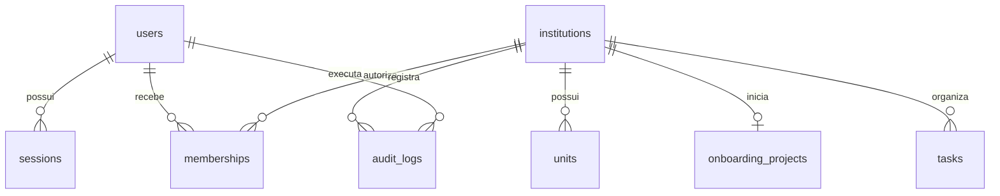

# Arquitetura e limites de segurança

Interface em `src/components`; rotas HTTP em `src/app/api`; serviços em `src/lib/service.ts`; autenticação em `src/lib/auth.ts`; schema Drizzle e SQL versionado em `src/lib` e `migrations`. Nenhuma biblioteca do cliente recebe hashes, senhas ou tokens de sessão no JSON.

## Modelo relacional atual

UUIDs, FKs, unicidade de email e de projeto por instituição, checks de status e índices de instituição/prazo e auditoria. `tasks.archived_at` e `units.archived_at` reservam arquivamento. Auditoria guarda ator, ação, entidade, instituição e data; não guarda senha nem descrição confidencial. Tarefas e registros de auditoria são gravados atomicamente. As migrações 001, 002 e 003 são registradas em schema_migrations com checksum; o runner serializa execuções com advisory lock, executa em transação e rejeita alterações em arquivos já aplicados. O banco anterior sem histórico é adotado executando a migração 001 idempotente. Nunca alterar uma migração já aplicada.

## Matriz de autorização implementada

| Perfil                                | Carteira   | Leitura institucional           | Escrita operacional | Criar instituição | Acolhimento |
| ------------------------------------- | ---------- | ------------------------------- | ------------------- | ----------------- | ----------- |
| Administrador da plataforma           | Todas      | Sim                             | Sim                 | Sim               | Negado      |
| Gestor atribuído                      | Atribuídas | Sim                             | Sim                 | Não               | Negado      |
| Diretor atribuído                     | Atribuídas | Sim                             | Não                 | Não               | Negado      |
| Especialista/RH/acolhimento atribuído | Atribuídas | Dados operacionais desta versão | Não                 | Não               | Negado      |
| Sem vínculo                           | Vazia      | Não                             | Não                 | Não               | Negado      |

O papel de acolhimento está reservado no modelo; nenhum dado individual de cuidado é coletado ou exposto. O endpoint correspondente sempre nega acesso, inclusive ao administrador. Os nomes dos papéis ainda são fixos; o administrador pode substituir suas permissões de tarefas, unidades, relatórios e auditoria por vínculo institucional. Null usa o padrão do papel; uma lista vazia remove todas essas permissões. Escopos por unidade e novos módulos permanecem pendentes.

Cada operação valida vínculo no servidor; alterações de tarefas filtram simultaneamente ID e instituição. Não há RLS no PostgreSQL nesta versão: isolamento é responsabilidade da camada de serviço e deve ser preservado em toda nova consulta. O usuário de banco local tem privilégios de desenvolvimento; criar papel limitado para produção.

## Autenticação

Senha com scrypt e salt aleatório; verificação em tempo constante. Token de 256 bits enviado somente em cookie HttpOnly/SameSite=Lax; apenas o hash é persistido. Expira em 8 horas; logout revoga no banco. Cookie Secure em produção. Limite persistido de 10 tentativas de login por conta em 15 minutos; isto não substitui limitação por IP no gateway. Mutação exige mesma origem; configurar APP_ORIGIN em implantação com proxy. Corpo JSON limitado a 16 KiB, entradas Zod, erros sem detalhes do banco. Cabeçalhos contra framing, detecção de tipo e permissões de dispositivos.

Há convites de uso único e recuperação local de demonstração; alteração de papel, revogação de vínculo e recuperação encerram todas as sessões da pessoa. Há MFA TOTP implementado com OTPAuth e segredo cifrado AES-256-GCM; faltam provedor de identidade/SSO maduro e entrega real por e-mail, revogação administrativa global independente, CSP de produção e revisão independente de segurança. Nunca usar esta fundação para narrativas clínicas, respostas psicossociais, dados reais de menores ou decisões trabalhistas. A arquitetura não constitui garantia de conformidade com a LGPD.

A tabela account_tokens armazena hashes de convites e recuperação, prazo de expiração, consumo e revogação. Convites vinculam instituição, papel, e-mail e administrador responsável. O token bruto nunca aparece em auditoria; links usam fragmentos e são removidos da barra após leitura pelo cliente. Ver docs/access.md.

A migração 003 acrescenta fuso IANA à instituição, permissões ao vínculo, tabela mfa_credentials e sinalizadores de segundo fator/restrição às sessões. Ver [fundação atual](fundacao-fase1.md) para controles e limitações.
